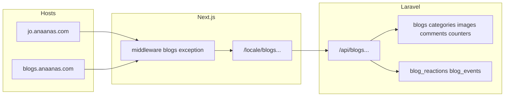

# خطة قسم الـ Blogs

## قرارات معتمدة

- المسارات موحّدة على كل الهوستات: `/{locale}/blogs` و `/{locale}/blogs/[slug]` و `/{locale}/blogs/category/[categorySlug]`.
- ساب دومين `blogs.{base}` لا يُعامل كدولة؛ يتجاوز تحويلات geo/`select-country` ويخدم نفس مسارات المدونة.
- المحتوى عام للمنصة (ليس حسب الدولة).
- التعليق والإعجاب يتطلبان تسجيل دخول (نفس سلوك المنشورات).
- المشاهدة تُسجَّل دائماً في Mongo (مع `user_id` إن وُجد، وإلا ضيف + meta)، وتزيد `blogs.views_count` في MySQL تراكمياً.
- لا نستخدم تاج `<header>` في صفحات المدونة (لتجنّب ستايل هيدر الموقع).



---

## 1) Backend — البيانات والعلاقات

Migrations (MySQL):

- `blog_categories`: `slug`, `name` JSON, `description` JSON nullable, `image` nullable, `is_active`, `sort_order`
- `blogs`: `blog_category_id`, `slug` unique, translatable `title`/`excerpt`/`content`/`seo_title`/`seo_description`, `cover_image`, `author_id` nullable (Admin/User), `status` (`draft`|`published`), `published_at`, `likes_count`, `views_count`, `comments_count`, soft deletes
- `blog_images`: `blog_id`, `image`, `sort_order`, soft deletes
- `blog_comments`: مثل [`Comment`](anaanasBackend/app/Models/Comment.php) — `blog_id`, `user_id`, `parent_id`, `body`, soft deletes

Mongo:

- `blog_reactions` — نسخة من [`PostReaction`](anaanasBackend/app/Models/PostReaction.php) (`blog_id`, `user_id`, `type`) مع مزامنة `blogs.likes_count`
- `blog_events` — نسخة من [`PostEvent`](anaanasBackend/app/Models/PostEvent.php) للأحداث `blog_view` (+ لاحقاً like/comment إن لزم) مع `user_id` و`meta`

Models: `BlogCategory`, `Blog`, `BlogImage`, `BlogComment`, `BlogReaction`, `BlogEvent` مع `HasTranslations` للحقول اللغوية.

---

## 2) Backend — Filament

مجموعة تنقل: **المدونة**

- `BlogCategoryResource` — على نمط Categories: `TranslatableTabs` للاسم/الوصف + slug + صورة + نشط/ترتيب
- `BlogResource` — على نمط [`CmsPageForm`](anaanasBackend/app/Filament/Resources/CmsPages/Schemas/CmsPageForm.php):
  - slug، تصنيف، حالة، تاريخ النشر، غلاف
  - tabs: عنوان / مقتطف / محتوى RichEditor (`json(false)`) / SEO
  - RelationManager للصور المتعددة [`PostImagesRelationManager`](anaanasBackend/app/Filament/Resources/Posts/RelationManagers/PostImagesRelationManager.php)
  - RelationManager للتعليقات (عرض/حذف)
- كل إدارة المدونة من اللوحة فقط (لا إنشاء من المستخدمين العاديين)

---

## 3) Backend — API العامة

في [`routes/api.php`](anaanasBackend/routes/api.php):

```
GET  /api/blog-categories?land=
GET  /api/blogs?land=&category=&page=
GET  /api/blogs/{slug}?land=
GET  /api/blogs/{blog}/comments
POST /api/blogs/{blog}/comments          auth
POST /api/blogs/{blog}/reactions         auth
GET  /api/blogs/{blog}/reactions
POST /api/blogs/{blog}/events            public|auth  (blog_view)
```

Controllers مستوحاة من `PostController` / `CommentController` / `PostReactionController` / `PostEventController`:

- عند `blog_view`: إنشاء وثيقة Mongo + `blogs.views_count += 1`
- عند toggle reaction: تحديث Mongo + `likes_count`
- عند تعليق جديد: زيادة `comments_count`

الاستجابة للمدونة الواحدة تشمل: المحتوى المترجم، التصنيف، الغلاف، معرض الصور، العدادات، `liked_by_me`.

---

## 4) Frontend — ساب دومين `blogs`

في [`lib/domain.ts`](anaanas-frontend-develop/lib/domain.ts):

- إضافة `'blogs'` إلى `RESERVED_SUBDOMAINS`

في [`middleware.ts`](anaanas-frontend-develop/middleware.ts):

- بعد `parseHost`: إذا أول label هو `blogs` → تخطّي redirects الخاصة بالدول/geo/`select-country`
- الإبقاء على فرض بادئة اللغة (`/ar`|`/en`)
- عدم تعيين `x-country` على هذا الهوست
- تعيين `x-blogs-host: 1` اختياري لتمييز الواجهة إن لزم

النتيجة:

- `https://blogs.anaanas.com/ar/blogs`
- `https://jo.anaanas.com/ar/blogs` (نفس التطبيق)

---

## 5) Frontend — الصفحات والتصميم

مسارات App Router:

- [`app/[locale]/(pages)/blogs/page.tsx`](anaanas-frontend-develop/app/[locale]/(pages)/blogs/page.tsx) — قائمة
- `blogs/category/[categorySlug]/page.tsx` — تصفية تصنيف
- `blogs/[slug]/page.tsx` — تفاصيل + تعليقات/إعجاب
- مكوّنات: `BlogCard`, `BlogFilters`, `BlogSidebar`, `BlogComments`, `BlogLikeButton`
- API client: `lib/api/blogs.ts`
- CSS Modules خاص بالمدونة (بدون تاج `header`)

مرجع بصري مركّب من:

- قائمة: شبكة بطاقات بأسلوب Events [`EventCard`](Social-Next_v1.1.0/TS/components/cards/EventCard.tsx) + تبويبات تصنيفات مثل Groups
- تفاصيل: تخطيط 8/4 من [`blogs` في القالب](Social-Next_v1.1.0/TS/app/(social)/(with-topbar)/blogs) + بطاقة محتوى + سايدبار مقالات ذات صلة
- تفاعل: نموذج تعليق + زر إعجاب تحت المقال (أنماط PostCard المبسّطة)

تسجيل المشاهدة: عند فتح التفاصيل، `POST /api/blogs/{id}/events` عبر BFF Next مثل منشورات (`app/api/blogs/...`).

---

## 6) ربطات تنقّل خفيفة

- إضافة رابط «المدونة» في السايدبار/الدرور عند الحاجة
- روابط مطلقة للساب دومين يمكن بناؤها لاحقاً من `blogs.{baseDomain}` إن رُغب؛ الافتراضي روابط نسبية `/[locale]/blogs`

---

## ترتيب التنفيذ

1. Migrations + Models + Relations
2. Filament BlogCategory + Blog (+ صور/تعليقات)
3. API Controllers + routes
4. Middleware/domain exception للـ `blogs`
5. Frontend list/detail + تفاعل + views
6. توثيق مختصر في `docs/` للـ backend والـ frontend
