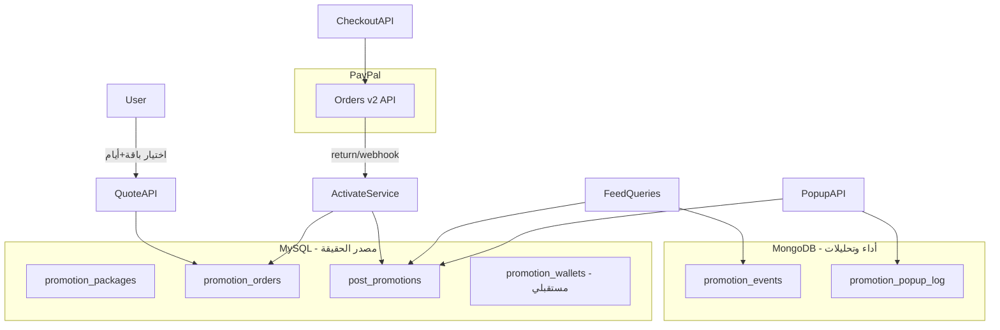
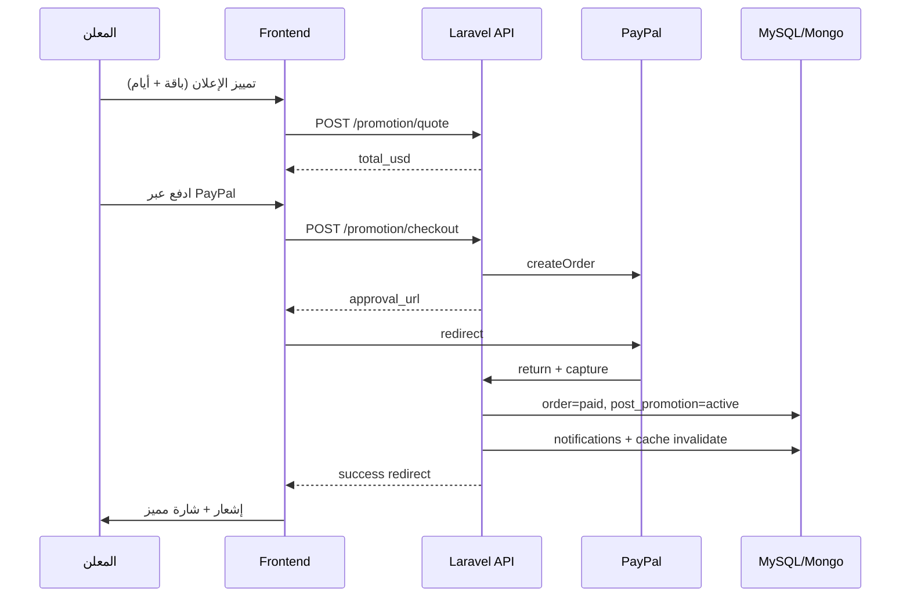

# خطة تمييز الإعلانات المدفوع (PayPal)

## الوضع الحالي (من مسح الكود)

| المجال | الحالة |
|--------|--------|
| إنشاء/تعديل/حذف | [`CreatePostCard.tsx`](d:\projeccts\ananaslatest\develop\anaanas-frontend-develop\components\cards\CreatePostCard.tsx)، [`post/[id]/edit`](d:\projeccts\ananaslatest\develop\anaanas-frontend-develop\app\[locale]\post\[id]\edit\page.tsx) |
| منشوراتي | موجود جزئياً في [`profile/feed`](d:\projeccts\ananaslatest\develop\anaanas-frontend-develop\app\[locale]\profile\feed\page.tsx) فقط؛ رابط [`/profile/my-posts`](d:\projeccts\ananaslatest\develop\anaanas-frontend-develop\components\dialogs\PostSuccessCelebrationModal.tsx) مكسور |
| تمييز/دفع | **غير موجود** في Backend أو Frontend (فقط mock في [`my-store`](d:\projeccts\ananaslatest\develop\anaanas-frontend-develop\app\[locale]\(pages)\my-store\storeClient.tsx)) |
| قوائم الإعلانات | [`SectionController::getPosts()`](d:\projeccts\ananaslatest\develop\anaanasBackend\app\Http\Controllers\Api\v1\SectionController.php) — ترتيب `newest/oldest/price` فقط |
| الرئيسية | [`HomeStatsController`](d:\projeccts\ananaslatest\develop\anaanasBackend\app\Http\Controllers\Api\v1\HomeStatsController.php) — `latest-listings`, `trending-posts` عضوي |
| إحصائيات | Mongo [`PostEvent`](d:\projeccts\ananaslatest\develop\anaanasBackend\app\Models\PostEvent.php) + [`statisticsClient.tsx`](d:\projeccts\ananaslatest\develop\anaanas-frontend-develop\app\[locale]\post\[id]\statistics\statisticsClient.tsx) |
| إشعارات | MySQL [`user_notifications`](d:\projeccts\ananaslatest\develop\anaanasBackend\app\Models\UserNotification.php) |
| لوحة التحكم | Filament v5 على `/back-office-v1` — [`PostResource`](d:\projeccts\ananaslatest\develop\anaanasBackend\app\Filament\Resources\Posts\PostResource.php) |

---

## اختيار حزمة PayPal

**الموصى به:** [`srmklive/paypal`](https://github.com/blendbyte/laravel-paypal) v3.1 (`composer require srmklive/paypal`)

| الخيار | ملاءمة |
|--------|--------|
| **srmklive/paypal** | Orders v2 (API حالي حتى 2027+)، Laravel 12، webhooks محلية، capture لمرة واحدة — **مناسب لشراء تمييز** |
| Laravel Spark + PayPal | اشتراكات SaaS فقط — **غير مناسب** ([مرجع Spark](https://laravel.com/blog/spark-stripe-paypal-support)) |

**التدفق:** `createOrder` → redirect PayPal → `capturePaymentOrder` على return + webhook `PAYMENT.CAPTURE.COMPLETED` للتأكيد.

**العملة:** USD موحّدة (حسب اختيارك).

---

## الباقات الافتراضية (Seed + قابلة للتعديل من الأدمن)

| الباقة | السعر/يوم | وزن الظهور | المميزات |
|--------|-----------|------------|----------|
| **أساسي** | $0.99 | x5 | شارة مميز على البطاقة، تثبيت في قوائم الأقسام/الفئات، أولوية في البحث |
| **متقدم** | $1.99 | x10 | كل ما سبق + تثبيت في الرئيسية + إشعار لمتابعي القسم |
| **بريميوم** | $3.99 | x20 | كل ما سبق + إعلان منبثق للزوار + إشعار لكل مستخدمي الدولة + تمييز في "إعلانات مشابهة" |

**مميزات إضافية مقترحة (تُضاف كـ flags):**
- `highlight_in_statistics` — تمييز فترة الترويج في الرسوم البيانية
- `priority_in_similar` — أولوية في كاروسيل الإعلانات المشابهة بصفحة التفاصيل

كل ميزة = عمود boolean أو JSON `features` في جدول الباقات؛ الواجهة تعرضها فور تغيير الباقة.

---

## معمارية البيانات (MySQL + MongoDB)



### جداول MySQL جديدة

**`promotion_packages`** — يديرها الأدمن
- `slug`, `name_ar/en`, `price_per_day_usd`, `appearance_weight` (5/10/20)
- `features` JSON: `{badge, listing_pin, homepage_pin, popup_ads, section_notify, country_notify, search_boost, similar_boost, stats_highlight}`
- `sort_order`, `is_active`

**`promotion_orders`**
- `user_id`, `post_id`, `package_id`, `days`, `unit_price`, `total_usd`
- `status`: `pending|paid|failed|cancelled|refunded`
- `paypal_order_id`, `paypal_capture_id`, `paid_at`
- `payment_source`: `paypal|wallet` (جاهز للمستقبل)
- `meta` JSON: locale, country_id, return_url

**`post_promotions`** — التفعيل الفعلي
- `post_id`, `user_id`, `package_id`, `order_id`
- `starts_at`, `ends_at`, `appearance_weight`, `features` (snapshot من الباقة وقت الشراء)
- `status`: `scheduled|active|expired|cancelled`
- فهارس: `(country_id, section_id, status, ends_at)`, `(post_id, status)`

**`promotion_wallets`** (أساس مستقبلي — جدول + migrations فقط في v1)
- `user_id`, `balance_days` أو `balance_usd`, `updated_at`
- `promotion_wallet_transactions` للحركات

### MongoDB

**`promotion_events`** (collection)
- `post_id`, `promotion_id`, `event`: `featured_impression|homepage_pin_view|popup_shown|popup_click|listing_boost_impression`
- `user_id?`, `country_id`, `section_id`, `created_at`
- يُدمج مع إحصائيات التمييز في [`PostController::statistics()`](d:\projeccts\ananaslatest\develop\anaanasBackend\app\Http\Controllers\Api\v1\PostController.php)

**`promotion_popup_log`** — منع إزعاج الزائر (cooldown 30 دقيقة افتراضياً per session/device)

### حقول خفيفة على `posts` (MySQL)
- `is_featured_active` boolean (denormalized cache للاستعلام السريع)
- `active_promotion_id` nullable FK — يُحدَّث عند التفعيل/الانتهاء عبر Job يومي

---

## Backend — API وخدمات

### Endpoints جديدة (`routes/api.php`)

| Method | Path | الوصف |
|--------|------|-------|
| GET | `/api/promotion/packages` | باقات نشطة + مميزات (عام) |
| POST | `/api/promotion/quote` | `{post_id, package_id, days}` → السعر الإجمالي |
| POST | `/api/promotion/checkout` | إنشاء order + PayPal redirect URL |
| GET | `/api/promotion/paypal/return` | capture + تفعيل |
| POST | `/api/promotion/paypal/webhook` | تأكيد idempotent |
| GET | `/api/promotion/posts/{post}/status` | حالة التمييز للمالك |
| GET | `/api/home/featured-posts` | مثبتة الرئيسية (country scoped) |
| GET | `/api/promotion/popup` | إعلان عشوائي مميز للزائر |
| GET | `/api/posts/my-posts` | **توسيع** — إرجاع `promotion` summary لكل منشور |

### خدمات Laravel جديدة

- [`PromotionQuoteService`](d:\projeccts\ananaslatest\develop\anaanasBackend\app\Services\) — حساب السعر، التحقق من ملكية المنشور + `status=active`
- [`PromotionPayPalService`](d:\projeccts\ananaslatest\develop\anaanasBackend\app\Services\) — create/capture/webhook عبر srmklive/paypal
- [`PromotionActivationService`](d:\projeccts\ananaslatest\develop\anaanasBackend\app\Services\) — بعد الدفع: إنشاء `post_promotions`، تحديث `posts.is_featured_active`، إطلاق إشعارات
- [`FeaturedFeedService`](d:\projeccts\ananaslatest\develop\anaanasBackend\app\Services\) — دمج المميزة في القوائم بوزن x5/x10/x20
- [`PromotionNotificationService`](d:\projeccts\ananaslatest\develop\anaanasBackend\app\Services\) — `promotion.section_boost`, `promotion.country_boost` عبر Queue chunks

### تعديل استعلامات القوائم

في [`SectionController::getPosts()`](d:\projeccts\ananaslatest\develop\anaanasBackend\app\Http\Controllers\Api\v1\SectionController.php):
1. جلب IDs المميزة النشطة للـ `country_id` + `section_id`/`category_id`
2. دمج weighted shuffle: كل منشور مميز يُكرر `appearance_weight` مرات في pool الاختيار العشوائي للمواضع العليا (أول 3–6 slots)
3. بقية القائمة بالترتيب العادي بدون تكرار

في [`HomeStatsController`](d:\projeccts\ananaslatest\develop\anaanasBackend\app\Http\Controllers\Api\v1\HomeStatsController.php):
- endpoint `featured-posts` أو تعديل `latest-listings` لإدراج شريط "إعلانات مميزة" أعلى الـ feed

### Jobs مجدولة
- `ExpirePostPromotionsJob` — يومياً: `status=expired`، `is_featured_active=false`
- `DispatchPromotionNotificationsJob` — chunked (500 مستخدم/دفعة) عند تفعيل باقة تتضمن `country_notify`

---

## Frontend

### 1. زر التمييز + Modal على PostCard

ملفات: [`PostCard.tsx`](d:\projeccts\ananaslatest\develop\anaanas-frontend-develop\components\cards\PostCard.tsx)، [`PostActions.tsx`](d:\projeccts\ananaslatest\develop\anaanas-frontend-develop\components\cards\components\PostActions.tsx)

- زر **"تمييز الإعلان"** يظهر للمالك فقط عندما `!post.is_featured_active`
- Modal جديد `FeaturePostModal.tsx`:
  - عرض مميزات الباقة (تتحدث live عند اختيار الباقة)
  - أزرار الأيام 1–30
  - ملخص السعر الإجمالي
  - زر "الدفع عبر PayPal" → redirect
- صفحات return/cancel: `app/[locale]/promotion/paypal/return/page.tsx` و `cancel/page.tsx`
- API proxies: `app/api/promotion/*`

### 2. تمييز بصري على البطاقة

- `PostCard.module.css` — border ذهبي، شارة "مميز"، أيقونة نجمة
- حقل `promotion` في [`PostRecord`](d:\projeccts\ananaslatest\develop\anaanas-frontend-develop\lib\api\posts.ts)

### 3. الرئيسية — تثبيت مميز

[`page.tsx`](d:\projeccts\ananaslatest\develop\anaanas-frontend-develop\app\[locale]\(pages)\page.tsx) + مكوّن `FeaturedPostsStrip.tsx` فوق [`Feeds`](d:\projeccts\ananaslatest\develop\anaanas-frontend-develop\app\[locale]\(pages)\home\components\Feeds.tsx)

### 4. إعلان منبثق

`FeaturedPopupAd.tsx` — client component في layout الصفحات العامة:
- يستدعي `GET /api/promotion/popup` كل 30 دقيقة (sessionStorage cooldown)
- يعرض بطاقة إعلان + رابط للتفاصيل
- يُسجّل `popup_shown` / `popup_click`

### 5. صفحة منشوراتي

مسار جديد: [`app/[locale]/my-posts/page.tsx`](d:\projeccts\ananaslatest\develop\anaanas-frontend-develop\app\[locale]\my-posts\page.tsx) (محمي بـ auth)

| عمود/إجراء | الوظيفة |
|------------|---------|
| صورة + عنوان + سعر | استعراض |
| شارة الحالة | active / pending / rejected |
| شارة التمييز | نشط حتى تاريخ / غير مميز |
| تعديل | → `/post/{id}/edit` |
| حذف | نفس منطق PostCard |
| تمييز | يفتح FeaturePostModal |
| إحصائيات | → `/post/{id}/statistics` |
| فلاتر | الكل / نشط / قيد المراجعة / مميز |

تحديث التنقل: [`SideBar.tsx`](d:\projeccts\ananaslatest\develop\anaanas-frontend-develop\components\layout\SideBar.tsx)، [`ProfileDropdown.tsx`](d:\projeccts\ananaslatest\develop\anaanas-frontend-develop\components\layout\TopHeader\ProfileDropdown.tsx)، إصلاح [`PostSuccessCelebrationModal`](d:\projeccts\ananaslatest\develop\anaanas-frontend-develop\components\dialogs\PostSuccessCelebrationModal.tsx)

### 6. إحصائيات التمييز

[`statisticsClient.tsx`](d:\projeccts\ananaslatest\develop\anaanas-frontend-develop\app\[locale]\post\[id]\statistics\statisticsClient.tsx):
- شريط فترات التمييز النشطة/السابقة فوق الرسوم
- KPIs إضافية: `featured_impressions`, `popup_views`, `boost_lift` (مقارنة قبل/بعد)
- تظليل المنطقة الزمنية للتمييز على line chart

Backend: توسيع `statistics()` بإرجاع `promotion_periods[]` + أحداث Mongo `promotion_events`

---

## لوحة التحكم Filament

موارد جديدة تحت مجموعة **المدفوعات**:

| Resource | المسار المقترح |
|----------|----------------|
| `PromotionPackageResource` | CRUD باقات + مميزات + سعر/يوم + وزن |
| `PromotionOrderResource` | عرض الطلبات، حالة PayPal، إعادة تفعيل يدوي |
| `PostPromotionResource` | المنشورات المميزة النشطة/المنتهية، إلغاء يدوي |

توسيع [`PostResource`](d:\projeccts\ananaslatest\develop\anaanasBackend\app\Filament\Resources\Posts\PostResource.php): RelationManager للترويجات والطلبات.

---

## الإشعارات أثناء الدفع

أنواع جديدة في `user_notifications`:

| type | متى |
|------|-----|
| `promotion.checkout_started` | عند إنشاء الطلب |
| `promotion.payment_completed` | بعد capture ناجح |
| `promotion.payment_failed` | فشل/إلغاء |
| `promotion.activated` | تفعيل التمييز للمالك |
| `promotion.section_featured` | لمتابعي القسم (باقة متقدم+) |
| `promotion.country_featured` | لكل مستخدمي الدولة (باقة بريميوم) |

---

## أساس رصيد التمييز (مستقبلي — v1 يجهّز فقط)

- جداول `promotion_wallets` + `promotion_wallet_transactions`
- `payment_source` على الطلب
- `PromotionActivationService` يقبل `source=wallet` (stub — لا UI شراء رصيد في v1)
- Filament: عرض الرصيد + تعديل يدوي للأدمن

---

## تدفق المستخدم



---

## متغيرات البيئة

```env
PAYPAL_MODE=sandbox
PAYPAL_SANDBOX_CLIENT_ID=
PAYPAL_SANDBOX_CLIENT_SECRET=
PAYPAL_LIVE_CLIENT_ID=
PAYPAL_LIVE_CLIENT_SECRET=
PAYPAL_WEBHOOK_ID=
PAYPAL_CURRENCY=USD
PROMOTION_POPUP_COOLDOWN_MINUTES=30
```

---

## ترتيب التنفيذ (إصدار كامل دفعة واحدة)

1. **Backend schema + seed packages** — migrations، models، seeder للباقات الثلاث
2. **PayPal integration** — srmklive/paypal، checkout/return/webhook، PromotionActivationService
3. **Feed injection** — FeaturedFeedService في SectionController + HomeStatsController
4. **Notifications + Jobs** — expire، country/section notify chunked
5. **Filament admin** — packages، orders، promotions
6. **Frontend modal + API proxies + return pages**
7. **PostCard visual + popup + homepage strip**
8. **صفحة منشوراتي + nav updates**
9. **Statistics promotion overlay**
10. **Docs** — [`docs/14-featured-posts-promotion.md`](d:\projeccts\ananaslatest\develop\anaanas-frontend-develop\docs\14-featured-posts-promotion.md)

---

## مخاطر ومعالجتها

| مخاطر | المعالجة |
|-------|----------|
| إشعار "كل المستخدمين" ثقيل | Queue بـ chunks + فقط مستخدمي `country_id` للمنشور |
| تكرار capture من PayPal | idempotency على `paypal_capture_id` unique |
| تعارض ترويجين لنفس المنشور | تمديد `ends_at` أو رفض مع رسالة واضحة (قرار: **تمديد** إن نفس الباقة، **استبدال** إن أعلى) |
| أداء القوائم | cache 60s لـ featured IDs per country/section؛ denormalize `is_featured_active` |
