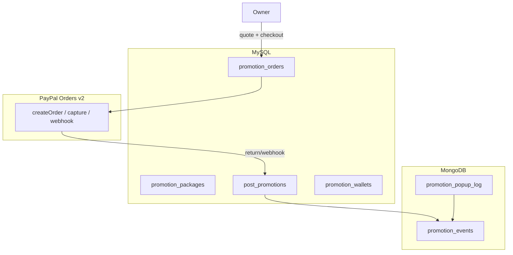
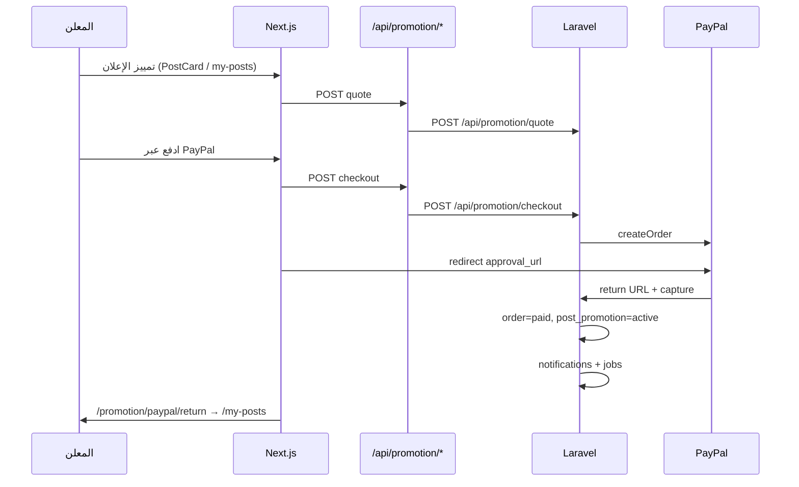

# تمييز الإعلانات المدفوع (PayPal) — توثيق شامل

**التاريخ:** 2026-07-05 — 2026-07-06  
**النطاق:** `anaanasBackend` (Laravel 12) + `anaanas-frontend-develop` (Next.js 15) + Filament v5  
**العملة:** USD موحّدة  
**حزمة PayPal:** `srmklive/paypal` v3.1 (Orders v2)

---

## فهرس

1. [نظرة عامة](#نظرة-عامة)
2. [الباقات الافتراضية](#الباقات-الافتراضية)
3. [معمارية البيانات](#معمارية-البيانات)
4. [Backend — الملفات والتغييرات](#backend--الملفات-والتغييرات)
5. [Frontend — الملفات والتغييرات](#frontend--الملفات-والتغييرات)
6. [API كاملة](#api-كاملة)
7. [تدفق الدفع](#تدفق-الدفع)
8. [Filament (لوحة التحكم)](#filament-لوحة-التحكم)
9. [Jobs والإشعارات](#jobs-والإشعارات)
10. [إحصائيات التمييز](#إحصائيات-التمييز)
11. [متغيرات البيئة](#متغيرات-البيئة)
12. [النشر والتشغيل](#النشر-والتشغيل)
13. [إصلاحات ما بعد التنفيذ](#إصلاحات-ما-بعد-التنفيذ)
14. [فحص يدوي](#فحص-يدوي)
15. [قرارات تقنية](#قرارات-تقنية)

---

## نظرة عامة

نظام تمييز الإعلانات يسمح لمالك المنشور بشراء باقة تمييز بالدولار عبر PayPal. بعد الدفع يُفعَّل التمييز تلقائياً.

**ما يحدث بعد التفعيل:**

| الميزة | الوصف |
|--------|--------|
| شارة «مميز» | border ذهبي + badge على `PostCard` |
| تثبيت القوائم | weighted shuffle في أعلى قوائم الأقسام/الفئات (x5/x10/x20) |
| شريط الرئيسية | `FeaturedPostsStrip` — إعلانات بباقة `homepage_pin` |
| إعلان منبثق | `FeaturedPopupAd` — باقة `popup_ads`، cooldown 30 دقيقة |
| إشعارات | متابعو القسم / مستخدمو الدولة حسب الباقة |
| إحصائيات | فترات التمييز + KPIs + تظليل على المخطط |

---

## الباقات الافتراضية

| الباقة | slug | السعر/يوم | الوزن | المميزات الرئيسية |
|--------|------|-----------|-------|-------------------|
| أساسي | `starter` | $0.99 | x5 | badge, listing_pin, search_boost, stats_highlight |
| متقدم | `pro` | $1.99 | x10 | + homepage_pin, section_notify |
| بريميوم | `premium` | $3.99 | x20 | + popup_ads, country_notify, similar_boost |

**مفاتيح `features` JSON:**

`badge`, `listing_pin`, `homepage_pin`, `popup_ads`, `section_notify`, `country_notify`, `search_boost`, `similar_boost`, `stats_highlight`

التعريف الكامل في `app/Support/PromotionFeatures.php`.

---

## معمارية البيانات



### MySQL

| جدول | الغرض |
|------|--------|
| `promotion_packages` | الباقات — slug, أسماء, سعر/يوم, وزن, features JSON |
| `promotion_orders` | طلبات الدفع — PayPal IDs, status, meta |
| `post_promotions` | التفعيل — starts_at/ends_at, snapshot للميزات |
| `promotion_wallets` | رصيد مستقبلي (v1: جداول فقط) |
| `promotion_wallet_transactions` | حركات الرصيد (مستقبلي) |

**حقول إضافية على `posts`:**

- `is_featured_active` — denormalized cache
- `active_promotion_id` — FK للترويج النشط

**Migration:** `database/migrations/2026_07_05_000000_create_promotion_tables.php`

### MongoDB

| Collection | الأحداث |
|------------|---------|
| `promotion_events` | `featured_impression`, `homepage_pin_view`, `popup_shown`, `popup_click`, `listing_boost_impression` |
| `promotion_popup_log` | منع تكرار المنبثق (cooldown per client_id) |

---

## Backend — الملفات والتغييرات

### Models

| الملف | الوصف |
|-------|--------|
| `app/Models/PromotionPackage.php` | باقات التمييز |
| `app/Models/PromotionOrder.php` | طلبات PayPal |
| `app/Models/PostPromotion.php` | التفعيل + `toSummaryArray()` |
| `app/Models/PromotionWallet.php` | محفظة مستقبلية |
| `app/Models/PromotionWalletTransaction.php` | حركات المحفظة |
| `app/Models/PromotionEvent.php` | Mongo — أحداث التحليلات |
| `app/Models/PromotionPopupLog.php` | Mongo — سجل المنبثق |
| `app/Models/Post.php` | + `is_featured_active`, `active_promotion_id`, relations |

### Services

| الملف | الوظيفة |
|-------|---------|
| `app/Services/PromotionQuoteService.php` | حساب السعر + التحقق من ملكية المنشور |
| `app/Services/PromotionPayPalService.php` | createOrder / capture / webhook عبر srmklive |
| `app/Services/PromotionActivationService.php` | تفعيل بعد الدفع، تمديد/استبدال الترويج |
| `app/Services/FeaturedFeedService.php` | دمج مميزة في القوائم، popup، تسجيل الأحداث |
| `app/Services/PromotionNotificationService.php` | إشعارات checkout/دفع/تفعيل/قسم/دولة |

### Controller

`app/Http/Controllers/Api/v1/PromotionController.php` — كل endpoints التمييز.

### تعديلات Controllers موجودة

| الملف | التغيير |
|-------|---------|
| `SectionController.php` | `getPosts()` — weighted shuffle للمميزة |
| `HomeStatsController.php` | `featuredPosts()` — شريط الرئيسية |
| `PostController.php` | `myPosts()` promotion meta، `similar()` boost، `statistics()` + promotion data |

### Jobs

| Job | الوظيفة |
|-----|---------|
| `ExpirePostPromotionsJob` | انتهاء الترويج + `is_featured_active=false` |
| `DispatchPromotionSectionNotificationsJob` | إشعار متابعي القسم (chunked 500) |
| `DispatchPromotionCountryNotificationsJob` | إشعار مستخدمي الدولة (chunked 500) |

**الجدولة:** `routes/console.php` — `ExpirePostPromotionsJob` كل ساعة.

### Config

| الملف | الوصف |
|-------|--------|
| `config/paypal.php` | إعدادات srmklive/paypal |
| `config/promotion.php` | cooldown المنبثق، URLs العودة |
| `composer.json` | + `srmklive/paypal` |

### Seeders

`database/seeders/PromotionPackageSeeder.php` — الباقات الثلاث.

### Support

`app/Support/PromotionFeatures.php` — defaults، normalize، catalog للميزات.

### Routes (`routes/api.php`)

```php
// عام
Route::get('home/featured-posts', ...);
Route::get('promotion/packages', ...);
Route::get('promotion/popup', ...);
Route::post('promotion/popup/click', ...);
Route::get('promotion/paypal/return', ...);
Route::get('promotion/paypal/cancel', ...);
Route::post('promotion/paypal/webhook', ...);

// محمي (auth:sanctum)
Route::post('promotion/quote', ...);
Route::post('promotion/checkout', ...);
Route::get('promotion/posts/{post}/status', ...);
```

---

## Frontend — الملفات والتغييرات

### مكوّنات التمييز (جديدة)

| الملف | النوع | الوظيفة |
|-------|-------|---------|
| `components/promotion/FeaturePostModal.tsx` | client | اختيار باقة + أيام + redirect PayPal |
| `components/promotion/FeaturePostModal.module.css` | CSS | أنماط المودال |
| `components/promotion/FeaturedPopupAd.tsx` | client | إعلان منبثق — يقرأ locale من `useParams()` |
| `components/promotion/FeaturedPopupAd.module.css` | CSS | أنماط المنبثق |
| `components/layout/FeaturedPopupAdLazy.tsx` | client | `dynamic(..., { ssr: false })` — تحميل كسول |
| `lib/api/promotion.ts` | lib | packages, quote, checkout, popup, featured |

### الرئيسية

| الملف | النوع | الوظيفة |
|-------|-------|---------|
| `app/[locale]/(pages)/page.tsx` | server | + `FeaturedPostsStrip`، تمرير `countryId` |
| `app/[locale]/(pages)/home/components/FeaturedPostsStrip.tsx` | server | جلب إعلانات مميزة من API |
| `app/[locale]/(pages)/home/components/FeaturedPostsStripClient.tsx` | client | عرض الشريط الأفقي |
| `app/[locale]/(pages)/home/components/FeaturedPostsStrip.module.css` | CSS | أنماط الشريط |

### Layout

`app/[locale]/layout.tsx` — إضافة `<FeaturedPopupAdLazy />` بجانب `AnnouncementModalLazy` (على كل الصفحات العامة).

### PostCard والإجراءات

| الملف | التغيير |
|-------|---------|
| `components/cards/PostCard.tsx` | شارة مميز، `FeaturePostModal`، `is_featured_active` |
| `components/cards/PostCard.module.css` | `.fbCardFeatured`, `.featuredBadge` |
| `components/cards/components/PostActions.tsx` | زر «تمييز» للمالك (`showFeature`, `onFeature`) |
| `components/cards/components/PostActions.module.css` | نمط `.feature` (ذهبي) |

### صفحة منشوراتي

| الملف | الوظيفة |
|-------|---------|
| `app/[locale]/my-posts/page.tsx` | صفحة server — جلب المنشورات |
| `app/[locale]/my-posts/layout.tsx` | حماية auth + redirect |
| `app/[locale]/my-posts/MyPostsClient.tsx` | فلاتر (الكل/نشط/قيد المراجعة/مميز) + تمييز/تعديل/إحصائيات |
| `app/[locale]/my-posts/myPosts.module.css` | أنماط الصفحة |

### صفحات PayPal

| الملف | الوظيفة |
|-------|---------|
| `app/[locale]/promotion/paypal/return/page.tsx` | نجاح الدفع → `/my-posts` |
| `app/[locale]/promotion/paypal/cancel/page.tsx` | إلغاء الدفع → `/my-posts` |

### BFF API Proxies (Next.js)

| Route | يوجّه إلى Laravel |
|-------|-------------------|
| `app/api/promotion/packages/route.ts` | `GET /api/promotion/packages` |
| `app/api/promotion/quote/route.ts` | `POST /api/promotion/quote` |
| `app/api/promotion/checkout/route.ts` | `POST /api/promotion/checkout` |
| `app/api/promotion/paypal/return/route.ts` | `GET /api/promotion/paypal/return` |
| `app/api/promotion/popup/route.ts` | `GET /api/promotion/popup` |
| `app/api/promotion/popup/click/route.ts` | `POST /api/promotion/popup/click` |
| `app/api/posts/my-posts/route.ts` | موجود مسبقاً — يُرجع promotion meta |

### التنقل (تحديث الروابط)

| الملف | التغيير |
|-------|---------|
| `components/layout/SideBar.tsx` | رابط «منشوراتي» → `/{locale}/my-posts` |
| `components/layout/TopHeader/ProfileDropdown.tsx` | عنصر «منشوراتي» |
| `components/dialogs/PostSuccessCelebrationModal.tsx` | إصلاح الرابط المكسور `/profile/my-posts` → `/my-posts` |

### إحصائيات التمييز

`app/[locale]/post/[id]/statistics/statisticsClient.tsx`:

- شريط **فترات التمييز** (نشط / منتهي / اسم الباقة)
- **KPIs إضافية:** featured_impressions, homepage_pin_views, popup_shown, popup_click, listing_boost_impressions
- **تظليل** فترات التمييز على مخطط المشاهدات (`ReferenceArea` من recharts)
- **boost_lift:** مقارنة متوسط المشاهدات أثناء التمييز vs الفترة العادية

`app/[locale]/post/[id]/statistics/postStatistics.module.css` — أنماط `.promoStrip`, `.promoPeriodChip`, `.promoKpiCard`.

---

## API كاملة

### Backend — عام

| Method | Path | الوصف |
|--------|------|-------|
| GET | `/api/promotion/packages` | باقات نشطة + feature_labels |
| GET | `/api/promotion/popup` | إعلان منبثق (`country_id?`, `client_id`, `land`) |
| POST | `/api/promotion/popup/click` | تسجيل نقرة |
| GET | `/api/promotion/paypal/return` | capture + تفعيل |
| GET | `/api/promotion/paypal/cancel` | إلغاء |
| POST | `/api/promotion/paypal/webhook` | تأكيد idempotent |
| GET | `/api/home/featured-posts` | شريط الرئيسية (`country_id`, `land`, `limit`) |

### Backend — محمي

| Method | Path | Body / Params |
|--------|------|---------------|
| POST | `/api/promotion/quote` | `{ post_id, package_id, days }` |
| POST | `/api/promotion/checkout` | `{ post_id, package_id, days, return_url, cancel_url, locale }` |
| GET | `/api/promotion/posts/{post}/status` | حالة التمييز للمالك |

### توسيعات endpoints موجودة

| Endpoint | حقول جديدة |
|----------|------------|
| `GET /api/posts/my-posts` | `is_featured_active`, `promotion` summary |
| `GET /api/posts/{post}/statistics` | `promotion_periods`, `promotion_totals`, `promotion_daily` |
| `GET /api/sections/.../posts` | دمج مميزة + promotion meta |
| `GET /api/posts/{post}/similar` | أولوية للمميزة |

---

## تدفق الدفع



---

## Filament (لوحة التحكم)

**المسار:** `/back-office-v1`  
**المجموعة:** المدفوعات

| Resource | الملف | الوظيفة |
|----------|-------|---------|
| باقات التمييز | `PromotionPackageResource` | CRUD باقات + ميزات + سعر/وزن |
| طلبات التمييز | `PromotionOrderResource` | عرض طلبات PayPal (قراءة فقط للإنشاء) |
| الإعلانات المميزة | `PostPromotionResource` | ترويجات نشطة/منتهية (قراءة فقط للإنشاء) |

**ملاحظة Filament v5:** نوع `$navigationGroup` يجب أن يكون:

```php
protected static \UnitEnum|string|null $navigationGroup = 'المدفوعات';
```

وليس `?string` فقط — وإلا يظهر FatalError عند فتح اللوحة.

---

## Jobs والإشعارات

### أنواع الإشعارات (`user_notifications`)

| type | متى |
|------|-----|
| `promotion.checkout_started` | إنشاء الطلب |
| `promotion.payment_completed` | capture ناجح |
| `promotion.payment_failed` | فشل/إلغاء |
| `promotion.activated` | تفعيل للمالك |
| `promotion.section_featured` | متابعو القسم (pro+) |
| `promotion.country_featured` | مستخدمو الدولة (premium) |

### إشعار الدولة

يُرسل لمستخدمين لديهم منشورات في `country_id` للإعلان **أو** يتابعون أقساماً فيها — وليس لكل `users` في النظام.

### تعارض ترويجين لنفس المنشور

| الحالة | القرار |
|--------|--------|
| نفس الباقة | **تمديد** `ends_at` |
| باقة مختلفة (أعلى/أقل) | **استبدال** أو جدولة حسب المنطق في `PromotionActivationService` |

---

## إحصائيات التمييز

### Backend response (`PostController::statistics`)

```json
{
  "promotion_periods": [{ "id", "status", "is_active", "starts_at", "ends_at", "package", "features" }],
  "promotion_totals": {
    "featured_impressions": 0,
    "homepage_pin_views": 0,
    "popup_shown": 0,
    "popup_click": 0,
    "listing_boost_impressions": 0
  },
  "promotion_daily": [{ "date": "2026-07-01", "featured_impression": 12, ... }]
}
```

### Frontend UI

- شريط chips لفترات التمييز فوق KPIs
- صف KPIs ذهبي عند وجود بيانات
- `ReferenceArea` على LineChart للفترات النشطة
- نص `boost_lift` عند توفر بيانات كافية

---

## متغيرات البيئة

### Backend (`anaanasBackend/.env`)

```env
PAYPAL_MODE=sandbox
PAYPAL_SANDBOX_CLIENT_ID=
PAYPAL_SANDBOX_CLIENT_SECRET=
PAYPAL_LIVE_CLIENT_ID=
PAYPAL_LIVE_CLIENT_SECRET=
PAYPAL_WEBHOOK_ID=
PAYPAL_CURRENCY=USD
PROMOTION_POPUP_COOLDOWN_MINUTES=30
PROMOTION_FRONTEND_RETURN_URL=https://{tenant}/{locale}/promotion/paypal/return
PROMOTION_FRONTEND_CANCEL_URL=https://{tenant}/{locale}/promotion/paypal/cancel
```

### Frontend (`anaanas-frontend-develop/.env`)

```env
NEXT_PUBLIC_API_BASE_URL=http://localhost:8000
NEXT_PUBLIC_BASE_DOMAIN=localhost:3000
```

---

## النشر والتشغيل

### Backend

```bash
cd anaanasBackend
composer install
php artisan migrate
php artisan db:seed --class=PromotionPackageSeeder
```

تأكد من تسجيل PayPal Webhook على:
`POST {API_URL}/api/promotion/paypal/webhook`

### Frontend

```bash
cd anaanas-frontend-develop
npm install
npm run build   # للإنتاج
npm run dev     # للتطوير
```

---

## إصلاحات ما بعد التنفيذ

### 1. Filament — `$navigationGroup` type error

**الخطأ:** `Type of ...$navigationGroup must be UnitEnum|string|null`

**الإصلاح:** في الموارد الثلاثة (`PromotionPackageResource`, `PromotionOrderResource`, `PostPromotionResource`):

```php
protected static \UnitEnum|string|null $navigationGroup = 'المدفوعات';
```

### 2. Webpack / `.next` تالف على الرئيسية

**الأعراض:**
- `Cannot read properties of undefined (reading 'call')` عند `page.tsx`
- `Cannot find module './4243.js'` أو `page.js` في dev
- `GET /ar/auth/sign-in 500`

**السبب:** تشغيل `npm run build` أو حذف `.next` بينما `npm run dev` يعمل.

**الإصلاح:**
1. إيقاف dev (`Ctrl+C`)
2. `Remove-Item -Recurse -Force .next`
3. `npm run dev`
4. نقل `FeaturedPopupAd` من `page.tsx` إلى `app/[locale]/layout.tsx` عبر `FeaturedPopupAdLazy`
5. فصل `FeaturedPostsStrip` → server + `FeaturedPostsStripClient`
6. إضافة BFF routes لـ `popup` و `popup/click`
7. استخدام `/api/promotion/popup` (نسبي) من المتصفح بدلاً من `getApiUrl` المباشر

### 3. `fetchMyPosts` في MyPostsClient

الاستجابة من API هي `{ data: PostRecord[] }` وليس مصفوفة مباشرة — تم إصلاح `rows.data`.

### 4. علم الدولة الفارغ

`GET /assets/flags/32x32/.png` — كود دولة فارغ في مكوّن العلم (مشكلة منفصلة، لا تمنع التمييز).

---

## فحص يدوي

- [ ] `php artisan migrate` + seeder ناجح
- [ ] Filament → المدفوعات → 3 موارد تفتح بدون خطأ
- [ ] تسجيل دخول → منشور `active` → زر **تمييز** → PayPal sandbox → عودة ناجحة
- [ ] شارة «مميز» على البطاقة
- [ ] شريط «إعلانات مميزة» على الرئيسية (عند وجود ترويج `homepage_pin`)
- [ ] إعلان منبثق بعد ~4 ثوانٍ (باقة premium، cooldown 30 دقيقة)
- [ ] `/{locale}/my-posts` — فلاتر + تمييز + تعديل + إحصائيات
- [ ] `/post/{id}/statistics` — فترات التمييز + KPIs + تظليل المخطط
- [ ] قوائم الأقسام — ظهور مميز في المواضع العليا
- [ ] إشعارات الدفع والتفعيل في `/notifications`

---

## قرارات تقنية

| الموضوع | القرار |
|---------|--------|
| PayPal SDK | `srmklive/paypal` Orders v2 (ليس Laravel Spark) |
| العملة | USD موحّدة |
| MySQL | packages, orders, promotions, wallets |
| MongoDB | promotion_events, promotion_popup_log |
| idempotency | `paypal_capture_id` unique |
| أداء القوائم | cache 60s + `is_featured_active` denormalized |
| رصيد التمييز | جداول جاهزة، بدون UI شراء رصيد في v1 |
| المنبثق | في `layout` وليس `page` — يظهر على كل الصفحات العامة |
| تحميل المنبثق | `dynamic(..., { ssr: false })` عبر `FeaturedPopupAdLazy` |

---

## أساس مستقبلي (v2)

- `promotion_wallets` + شراء رصيد أيام/USD
- `payment_source=wallet` في `PromotionActivationService`
- Filament: تعديل رصيد المستخدم يدوياً
- RelationManager على `PostResource` للترويجات والطلبات

---

*آخر تحديث: 2026-07-06*
